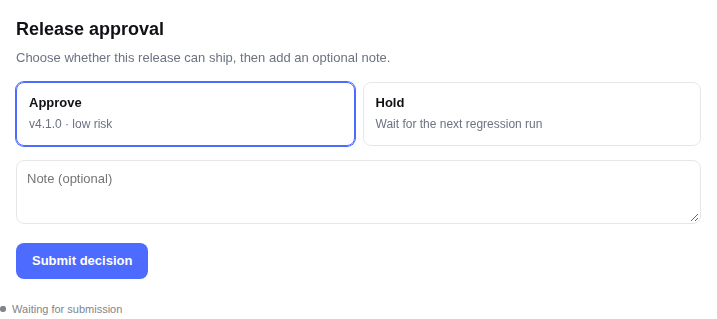

# dsh-surface

**Live pages in the conversation. Preview, report, or ask.**

[](https://www.npmjs.com/package/dsh-surface)
[](https://github.com/woolsen/dsh-surface/actions/workflows/ci.yml)
[](LICENSE)
[](package.json)

`dsh-surface` is a [DeepSeekRuntime](https://github.com/deepseek-ai/deepseek-harness) plugin that renders a complete HTML page inside the conversation. Use it for UI previews, data reports, mockups, calculators — or for forms and approvals where the page can send a structured answer back to the agent **through the same tool call**.



## Why

Most chat UIs can show text or a fixed component tree. A page is different: it can lay out a real report, run a chart, look exactly like the UI you are building, and collect an answer without making the user translate their choice into prose.

`dsh-surface` gives the model one tool:

- **render a page** — a self-contained HTML document, sandboxed, themed with the host's tokens, auto-sized;
- **optionally wait for it** — the tool call blocks until the user submits, cancels, or the timeout expires;
- **return data, not prose** — the page calls `dshSurface.submit(data, summary)` and the agent receives `{ answered, summary, data }` in the same turn.

It is not a component library, and it is not an artifact manager. It is the page surface between the model and the user.

## Features

- **Any self-contained HTML** — inline CSS/JS, SVG, canvas; no external requests.
- **Sandboxed by default** — opaque origin, no `allow-same-origin`, CSP blocks network, forms, nested frames, and top-level navigation.
- **Follows the host theme** — `--dsw-*` tokens are bridged to `--background`, `--foreground`, `--chart-*`, `--radius`, and friends.
- **Auto height** — the frame reports its content height and the card sizes itself.
- **Blocking answers** — `awaitAnswer`-style semantics without a separate question panel.
- **OpenChamber-compatible pages** — `window.openchamber.submit(data, summary)` is an alias of `window.dshSurface`.
- **Small and auditable** — one host file, one client bundle, a 12-case test suite.

## Install

Requires DeepSeekRuntime with the Web UI (`dsh web`) and Node.js `^22.19.0 || >=24`.

```sh
dsh plugin --profile web add dsh-surface
```

Restart `dsh web`, then refresh the browser. The plugin activates on the next session.

> The package is published as `dsh-surface`. If you are installing from a checkout instead, use `dsh plugin --profile web add link:/path/to/dsh-surface` and run `npm install && npm run build` first.

## Use it

Ask for a page, or point the model at one:

> Render a one-page Q3 revenue report with a bar chart and a table. Use the `render` tool; make the page self-contained.

> Here is our release checklist. Render it as a page with an approve / reject choice and a note field. On submit call `dshSurface.submit({ decision, note }, summary)`.

The model calls the `render` tool with a complete HTML document. The page appears in the tool card. If it calls `dshSurface.submit`, the call stays open until the answer arrives.

### Tool reference

| Field            | Type   | Required | Meaning                                                       |
| ---------------- | ------ | -------- | ------------------------------------------------------------- |
| `html`           | string | yes      | A complete, self-contained HTML document (max 200,000 bytes). |
| `title`          | string | no       | Card title; the page's own `<title>` still names the frame.   |
| `timeoutSeconds` | number | no       | How long to wait for a submission. Default 600, max 3600.     |

The tool returns one JSON string:

```json
{ "answered": true, "summary": "Approved with a note", "data": { "decision": "approve", "note": "ship it" } }
```

On timeout it returns `{ "answered": false, "reason": "timeout" }`. On cancellation the call fails with the host's cancellation error.

### Page API

Inside the page:

```html
<button onclick="dshSurface.submit({ decision: 'approve' }, 'Approved')">Approve</button>
```

| API                                | Meaning                                                                                                                                                                     |
| ---------------------------------- | --------------------------------------------------------------------------------------------------------------------------------------------------------------------------- |
| `dshSurface.submit(data, summary)` | Send the answer. `data` must be JSON-serializable (≤ 16 KB); `summary` is a short human-readable line (≤ 500 chars). Returns a Promise. Must be called from a user gesture. |
| `dshSurface.answered`              | Whether an answer has been accepted.                                                                                                                                        |
| `dshSurface.answer`                | The accepted answer, when available.                                                                                                                                        |
| `dshRender` / `openchamber`        | Aliases kept for pages written before the rename.                                                                                                                           |

The page may also listen for `dsh-surface:result` on `window` to react to the host's acknowledgement.

## Security model

- The page runs in an iframe with `sandbox="allow-scripts allow-forms"` and **no** `allow-same-origin`. It has an opaque origin and cannot read the host page, cookies, or storage.
- A document-level CSP allows inline scripts/styles and `data:` images, and blocks `connect-src`, nested frames, forms, and navigation.
- The submission route is registered on the host's authenticated `/api` channel (`ctx.connection.fetch`). Only the owner peer reaches it; the host checks Host/Origin and browser authentication before the handler runs.
- Payload limits: 500-character summary, 16 KB JSON data, 200 KB HTML.
- Pages should not ask for secrets. Treat any page content as untrusted.

See [docs/architecture.md](docs/architecture.md) for the full lifecycle.

## Compatibility

| Surface                | Status                                                                          |
| ---------------------- | ------------------------------------------------------------------------------- |
| `dsh web` (0.2.1-rc.2) | Tested end to end                                                               |
| dsh headless / TUI     | No page surface; the tool waits until its timeout and returns `answered: false` |
| Desktop (Electron)     | Not yet verified; custom `fetch` over the desktop IPC bridge needs a real run   |

## Known limitations

1. **The page folds when the turn ends.** The card lives inside the tool-call group; after the turn settles, that group collapses. The answer remains visible in the transcript, and expanding the group brings the page back. A `conversation.chat.turnTail` card is the planned fix.
2. **No local images yet.** Only `data:` / inline images render; reading workspace files and enforcing a budget is not implemented.
3. **HTML lives in the tool arguments.** A large page is part of the session log and may be resent with later turns. An artifact-backed page (short id + file) is the planned improvement.
4. **No waiting notification.** If you switch sessions, nothing tells you that a page is waiting; the tool does not appear in a global inbox.
5. **A host restart loses the wait.** The pending map is in memory; after a restart the call is interrupted and the page becomes read-only.
6. **No persistence or versions.** The plugin stores nothing of its own; every render is a new call.

## Development

```sh
npm install
npm run check      # lint + typecheck + tests + build + format check
npm test           # node:test
npm run build      # lib/index.js + lib/client.js
```

Project layout:

```text
src/index.ts              host: render tool, wait registry, answer route
src/wait.ts               pending calls (first answer wins, cancel, timeout)
src/answer.ts             POST body validation and responses
src/client/index.tsx      client plugin: tool.call.toolview registration
src/client/RenderCard.tsx iframe card, theme, height, submit bridge
src/client/shell.ts       frame document, CSP, height script, bridge
src/client/theme.ts       --dsw-* → page variables
tests/                    wait/answer unit tests
examples/approval.html    a ready-to-use approval page
```

See [CONTRIBUTING.md](CONTRIBUTING.md) before opening a pull request.

## License

MIT © 2026 woolsen
