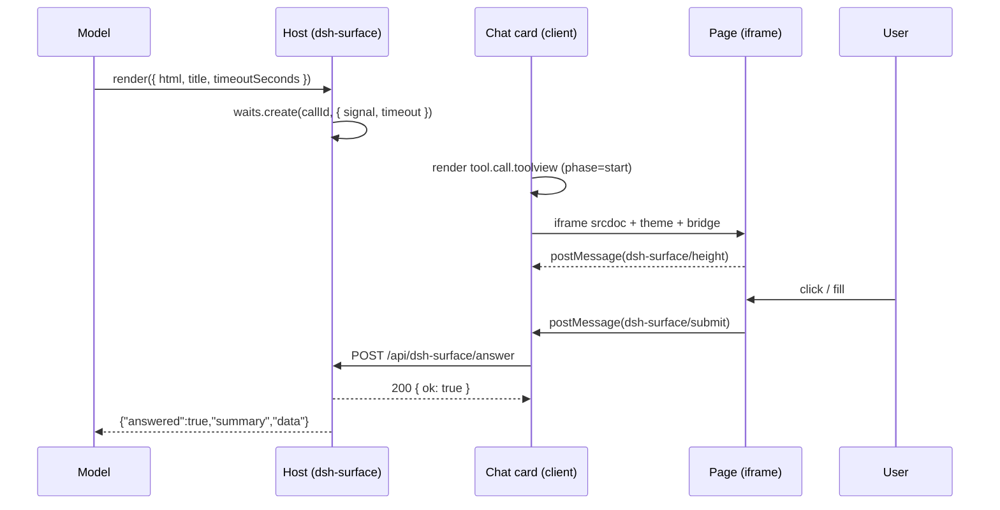

# Architecture

`dsh-surface` has three moving parts: a host tool, a client tool view, and one authenticated HTTP route.

## Host half (`src/index.ts`)

- Registers the `render` tool with `defineTool`. It intentionally declares **no** `timeoutMs`; the only deadline is the per-call `timeoutSeconds`.
- Validates `html` (non-empty, ≤ 200 KB), `title` (≤ 120 chars), and `timeoutSeconds` (positive, capped at 3600).
- Calls `waits.create(exec.callId, { signal: exec.signal, timeoutMs })` and returns the JSON-encoded result.

The `waits` registry (`src/wait.ts`) is a `Map<callId, entry>`:

- first answer wins; later answers get `not-waiting` (HTTP 404);
- `exec.signal` aborts the wait with an `ABORTED` error;
- timeout resolves `{ answered: false, reason: 'timeout' }` instead of hanging the turn;
- the entry is removed on every settle, so the map cannot grow without bound.

## Answer route (`src/answer.ts`)

Registered with `ctx.connection.fetch.register` on the host's authenticated `/api` channel:

| Property   | Value                                                                         |
| ---------- | ----------------------------------------------------------------------------- |
| Path       | `/api/dsh-surface/answer`                                                     |
| Methods    | `POST`                                                                        |
| Body       | buffered JSON                                                                 |
| Reached by | owner peer only; the host checks Host/Origin and browser authentication first |

Validation:

- `callId`: non-empty string, ≤ 200 chars;
- `summary`: trimmed non-empty string, ≤ 500 chars;
- `data`: JSON-serializable, ≤ 16,000 bytes when encoded (413 otherwise).

Status codes: `200` accepted, `400` invalid payload, `404` not waiting / already answered, `405` wrong method, `413` data too large.

## Client half (`src/client/`)

- `index.tsx` registers the keyed slot `tool.call.toolview` with `key: 'render'`; an unregistered name would fall back to the generic tool row.
- `RenderCard.tsx` reads the call's `argsRaw` (the argument stream may be incomplete; incomplete JSON renders a “preparing page” row), builds the frame document, and listens for two messages from that frame only (`event.source === iframe.contentWindow`):
  - `dsh-surface/height` → clamp to 120–1400 px;
  - `dsh-surface/submit` → validate, POST, and post the result back to the frame.
- `shell.ts` builds the final document: `<meta charset>`, viewport, CSP, theme CSS, the `dshSurface` bridge, and the height reporter. Head additions are inserted after `<head>`, else after `<html>`, else after the doctype, else prepended — the authored markup is otherwise untouched.
- `theme.ts` resolves `--dsw-*` tokens at render time and maps them to a small stable vocabulary (`--background`, `--foreground`, `--chart-1..6`, …). A `MutationObserver` on the root/body plus `prefers-color-scheme` re-renders the document when the host theme changes.

## Security boundaries

1. **Frame**: opaque origin (`sandbox="allow-scripts allow-forms"`, no `allow-same-origin`), so the page cannot reach the host document, cookies, or storage.
2. **Network**: document CSP `connect-src 'none'`, `frame-src 'none'`, `form-action 'none'`, `default-src 'none'`; only inline scripts/styles and `data:`/`blob:` images are allowed.
3. **Host bridge**: only `postMessage` from the exact frame is accepted; the answer route is owner-peer-only and re-validates every field; the browser gesture requirement prevents a page from auto-submitting on load.
4. **Limits**: HTML 200 KB, summary 500 chars, data 16 KB, height 120–1400 px.

The page is still model-authored HTML. Treat it as untrusted content: it can render misleading text or links (links open outside the frame), and it should never be used for secrets.

## Failure behaviour

| Event               | Result                                                                    |
| ------------------- | ------------------------------------------------------------------------- |
| User submits        | `200`; tool returns `{ answered: true, ... }`                             |
| Second submit       | `404`; the page receives `ok: false, error: not-waiting`                  |
| Timeout             | tool returns `{ answered: false, reason: 'timeout' }`                     |
| Tool call cancelled | wait rejects `ABORTED`; the tool fails with the host's cancellation error |
| Host restarts       | the in-memory wait disappears; the call is interrupted on resume          |
| Page closed         | nothing happens; the call stays open until submit/cancel/timeout          |

## Deliberate decisions

- **No storage.** The page is derived from the call's own arguments, so replay needs no side store; the trade-off is that large HTML lives in the session log.
- **No turn-tail card yet.** The tool card is enough while the call is running; after a turn settles the host folds tool calls, which hides the page. `conversation.chat.turnTail` is the planned fix.
- **No built-in question UI reuse.** The host's `userQuestions` seam only speaks option/text questions; a page needs its own submit route, which is why this plugin owns one.
